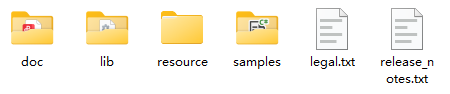
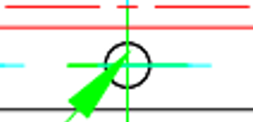
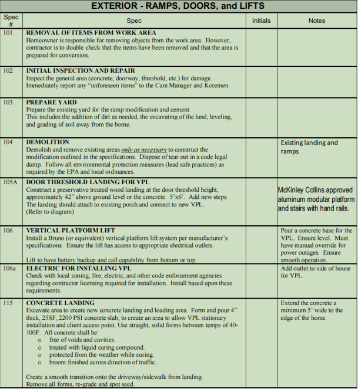
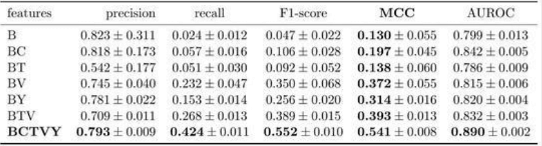

# 1. Overview

PDFSolid Conversion SDK is a high-performance library designed for extracting and transforming the data within your PDF files, such as text, images, tables, links, and annotations, into various file formats. Our Conversion SDK retains the original document layout and the properties of the file data, ensuring a seamless document conversion experience.

Effortlessly integrate the PDFSolid Conversion SDK into your projects in just a few steps, and enable the following file format conversions:

- Convert PDF to Word (.docx)
- Convert PDF to Excel (.xlsx)
- Convert PDF to PowerPoint (.pptx)
- Convert PDF to HTML (.html)
- Convert PDF to CSV (.csv)
- Convert PDF to Image (.png, .jpg, .jpeg, .jpeg2000, .bmp, .tiff, .tga, .gif, .webp)
- Convert PDF to Plain Text (.txt)
- Convert PDF to Rich Text Format (.rtf)

- Convert PDF to Searchable PDF (.pdf)


- Convert PDF to OFD (.ofd)

- Convert PDF to Structured Data (.json)
- Convert PDF to Markdown (.md)

- Convert Word to PDF (.docx to .pdf)


Harness the power of PDFSolid Conversion SDK and take your document processing to the next level with intelligent tools designed for accuracy and efficiency. To enhance your format conversion results, PDFSolid offers AI-powered document tools with the following capabilities:


- Optical Character Recognition (OCR)


- Layout Analysis


- Table Recognition


## 1.1 Why PDFSolid Conversion SDK

- Mature Technology

  With years of technology accumulation, we have established a complete mechanism of product iteration to offer a continuous guarantee for product competitiveness.

- Complete PDF and Format Conversion Functionalities

  Our comprehensive features can meet diverse needs and are easy for our customers to use without training costs.

- High-quality Service

  professional service and technical support to quickly respond to users' feedback through onsite service or remote support like telephone, email, etc.

- Independent Intellectual Property Rights

  Our technology is independent and compliant with ISO, helping enterprises conduct international business without considering copyright risks.

## 1.2 PDFSolid Conversion SDK

The PDFSolid Conversion SDK is designed to facilitate the effortless conversion of PDF files into various other formats, all while preserving the original layout and formatting of the documents. In this guide, we will explore the PDFSolid Conversion SDK and demonstrate how to utilize it within your Java projects.

## 1.3 License & Trial

The PDFSolid Conversion SDK is a commercial SDK that requires a license to grant developers the right to develop and distribute their applications. In development mode, each license is only valid for one device ID. PDFSolid provides flexible licensing models, please contact our sale's team for more information. However, even if you have a license, it is prohibited to distribute any documents, sample code, or source code of the PDFSolid Conversion SDK to any third parties.

If you do not have a License, please feel free to contact the PDFSolid Team to obtain a License to try the PDFSolid Conversion SDK.
# 2. Get Started


## 2.1 Requirements
Before starting, please make sure that you have already met the following prerequisites.

### 2.1.1 Get PDFSolid License Key

PDFSolid provides two types of license key: 30-day free trial license, and commercial license.

#### How to Get Free Trial License

Contact our sales team and we'll send you a 30-day free trial license for PDFSolid Conversion SDK.

#### How to Get Commercial License

PDFSolid Conversion SDK is a commercial SDK that requires a license for application release. Any documents, sample code, or source code distribution from the released package of PDFSolid to any third party is prohibited.

**Contact Sales**

To get commercial license for PDFSolid Conversion SDK, feel free to contact our sales team.

For Java Conversion SDK, the formal license must be bound to your developer device ID (How to find the developer device ID), and each license is only valid for one device ID in development mode.


### 2.1.2 Download Conversion SDK

Check [GitHub Releases](https://github.com/PDFSolid/pdfsolid-conversion-java/releases) for published assets. For v1.3.0, `PDFSolid_Conversion_java_1_3_0.zip` bundles Windows x64, Linux x64, and macOS (Intel and Apple Silicon). `PDFSolid_Conversion_linux_java_1_3_0.zip` is optional and bundles Linux x64 only. Use `lib/pdfsolidconversionsdk.jar` and `resource/` from the chosen SDK ZIP; a Git checkout or GitHub source archive does not include the JAR. If the required asset is not listed, contact [sales@pdfsolid.com](mailto:sales@pdfsolid.com).


### 2.1.3 System Requirements

| Platform | System Requirements | Development Environment | Notes |
| :------ | :------ | :------ | :------ |
| Linux | - Linux x64.<br /> - GLIBC 2.31 or higher. | JDK 8 or higher. | Samples have been tested on Ubuntu 20.04. |
| Windows | - Windows 7, 8, 10, and 11 64-bit | JDK 8 or higher. |  |
| macOS | - macOS 11.0 or higher (Intel x86_64, Apple Silicon arm64). | JDK 8 or higher. |  |

## 2.2 SDK Package Structure

The PDFSolid Conversion SDK for Java contains the following files:


- ***"doc"*** - API reference and developer guide.
- ***"lib"*** - Contains PDFSolid Conversion Java SDK JAR.
- ***"resource"*** - Contains runtime resources and DocumentAI models.
- ***"samples"*** - A folder containing Java sample projects.
- ***"release_notes.txt"*** - Release notes.
- ***"legal.txt"*** - Legal and copyright information.




**About AI model files:** The SDK package bundles the base model `documentai.model` by default, so the default configuration (layout analysis, OCR, and balanced-profile table recognition) needs no extra download. Download the corresponding extension model packages from https://download.pdfsolid.com/download/models only when you need extended capabilities such as high-accuracy table recognition, high-accuracy OCR, or document orientation classification and correction. See "Model Package Reference" in the "Set DocumentAI Model" chapter.
### 2.2.1 Apply the License Key
If you don't have a license key, please check out [how to obtain a license key](#211-get-pdfsolid-license-key).

PDFSolid Conversion SDK currently supports offline authentication to verify license keys.

*Learn about:*

*What is the authentication mechanism of PDFSolid's license?*

#### Copy the License Key

Accurately obtaining the license key is crucial for the application of the license.

1. In the email you received, locate the XML file containing the license key.
2. Open the XML file, and determine the license type based on the `<type>` field. If `<type>online</type>` is present, it indicates an online license. If `<type>offline</type>` is present or if the field is absent, it indicates an offline license.

**Online License**:

```xml
<?xml version="1.0" encoding="UTF-8" standalone="no"?>
<license version="1">
    <platform>linux</platform>
    <starttime>xxxxxxxx</starttime>
    <endtime>xxxxxxxx</endtime>
    <type>online</type>
    <key>LICENSE_KEY</key>
</license>

```

**Offline License**:

```xml
<?xml version="1.0" encoding="UTF-8" standalone="no"?>
<license version="1">
    <platform>linux</platform>
    <starttime>xxxxxxxx</starttime>
    <endtime>xxxxxxxx</endtime>
    <key>LICENSE_KEY</key>
</license>

```

3. Copy the value located at the LICENSE_KEY position within the `<key>LICENSE_KEY</key>` field. This is your license key.

#### Apply the License Key
You can perform offline authentication using the following method:

Before using the classes and methods of the PDFSolid Conversion SDK in your project, you need to initialize the SDK with a valid license key. If you don’t have a license key, feel free to contact the PDFSolid team to obtain one.

```java
import com.pdfsolid.conversion.base.ErrorCode;
import com.pdfsolid.conversion.LibraryManager;

String license = " ";
ErrorCode errorCode = LibraryManager.licenseVerify(license);
if (errorCode != ErrorCode.SUCCESS) {
    return;
}

String resourcePath = "";
LibraryManager.initialize(resourcePath);
```


#### Query the License Type

After the license is verified, call `LibraryManager.getLicenseType` to get the type of the currently verified license. It does not verify the license again and does not consume page quota.

| Return value | Meaning |
| --- | --- |
| `LicenseType.UNKNOWN` (0) | No license has been verified, verification failed, or the SDK is releasing |
| `LicenseType.TRIAL` (1) | Trial license |
| `LicenseType.FORMAL` (2) | Formal license |

```java
LicenseType licenseType = LibraryManager.getLicenseType();
if (licenseType == LicenseType.TRIAL) {
    System.out.println("Trial license");
}

```
## 2.3 How to Run a Demo


PDFSolid Conversion SDK provides demos in the **"samples"** folder.

Before running the demo, make sure you have configured your environment correctly and installed JDK 8 or higher on your machine. To run the demo, follow these steps:

1. Open a terminal window and navigate to the **"samples"** folder of the PDFSolid Conversion SDK.
2. Enter the following command to run the demo:

```shell
./run_demo.sh
```

Output files (Word, Excel, PowerPoint, etc.) will be generated in the **"samples/output"** folder.
# 3. Conversion Guides

PDFSolid Conversion SDK allows developers to use a simple API to convert PDF to commonly used file
formats such as Word, Excel, PowerPoint, HTML, CSV, PNG, JPEG, RTF, TXT, Searchable PDF, OFD, JSON, and Markdown. It provides a wide range of customized conversion
options, such as whether to include images or annotations in PDF documents, whether to enable OCR, whether to enable layout analysis, and more.
## 3.1 Conversion Guides

PDFSolid Conversion SDK allows developers to use a simple API to convert PDF to the most commonly used file formats like Word, Excel, PPT, HTML, CSV, PNG, JPEG, RTF, CSV,etc. Provide a wealth of customized conversion options, such as whether to include images or annotations in PDF documents, whether to enable OCR or layout analysis, etc.

### 3.1.1 Initialize Library Resources
**Overview**

Initialize the necessary file and memory resources required by the PDFSolid Conversion SDK.

**Notes**

- When using the PDF to Searchable PDF feature, you must provide the full path to the `resource` directory in the SDK package.

- When using OCR, Layout Analysis, PDF to Searchable PDF, or PDF to OFD, make sure the font resources and DocumentAI model resources in the `resource` directory are available.
- Lifecycle: if synchronous conversion tasks are still running when `LibraryManager.release` is called, the release is deferred until the last task returns, and new tasks are refused in the meantime. Unload the SDK only after all conversion calls have returned. See "Release Library Resources" for details.


```java
// Initialize SDK resources.
LibraryManager.initialize("PDFSolid_Conversion_SDK/resource");
```


#### **Other Library Interfaces**

- `LibraryManager.getVersion`: gets the SDK version string.
- `LibraryManager.setLogger`: enables or disables info-level and warning-level log messages separately.
- `LibraryManager.getPageCount`: returns the number of pages in a document, taking the password needed to open it if any; returns `-1` while library resources are being released or configured.
- `LibraryManager.getRemainingPageQuota`: returns the remaining page quota of the license. `>= 0` is the number of remaining pages, `-1` means not initialized, `-2` means unlimited, and `-3` means the quota file is corrupted.
## 3.2 Set DocumentAI Model

#### **Overview**

Before using OCR, Layout Analysis, Table Recognition you need to set the DocumentAI model path first.

The SDK package bundles the base model `documentai.model` by default. With the default configuration you only need to pass its path to `setDocumentAIModel`; no extra download is required.


`setDocumentAIModel` supports an optional `gpuId` parameter used to specify the GPU device index for the AI model. When `gpuId` is `-1`, GPU acceleration is disabled.

#### **Set AI Model Instance Count**

If you need to control the number of Layout Analysis and Table Recognition model instances, call `LibraryManager.setDocumentAIModelCount` to set the layout analysis and table recognition model instance counts separately.


#### **Use Your Own AI Engine (SDK v1.1.0+)**

This option is available only in SDK v1.1.0 or later. You can skip `setDocumentAIModel` and plug in your own OCR, Layout Analysis, or Table Recognition engine through the callbacks on `ConvertCallback`. See [Use Custom AI Models via Callbacks](#311-use-custom-ai-models-via-callbacks) for details.


#### **Sample**

```java
int gpuId = 0;
LibraryManager.setDocumentAIModel("path/model", gpuId);
```


#### **Incremental Loading of Model Packages**

Models are provided as packages. Each call to `setDocumentAIModel` loads only the capabilities contained in that file and **merges them with the capabilities already loaded instead of replacing them**; the loading order does not matter. If a package fails to load, **the capabilities already loaded are kept** and a specific error code is returned; there is no silent downgrade.

Calling `LibraryManager.releaseAIModel` releases all loaded models; load them again before using AI features afterwards. While conversion tasks are running or a release is still pending, reconfiguring the DocumentAI model is refused and `ErrorCode.CONVERTING` is returned. Load or reload models only after all conversion tasks have finished.

```java
LibraryManager.setDocumentAIModel("path/documentai.model", -1);
LibraryManager.setDocumentAIModel("path/table_legacy.model", -1);

```

#### **Model Package Reference**

Download address for all model packages (including the base package): https://download.pdfsolid.com/download/models

| File | Size | Purpose | How to obtain / When needed |
| --- | --- | --- | --- |
| `documentai.model` | About 230 MB | Base package: layout analysis, table recognition (balanced profile), and all basic OCR languages | Bundled in the SDK package; required by every AI feature (layout analysis, OCR, table recognition) |
| `table_legacy.model` | About 270 MB | Table extension package: resources such as bordered / borderless table detection required by the high-accuracy profile | Download separately; needed only when `tableRecognitionAccuracy` is set to `TableRecognitionAccuracy.HIGH_ACCURACY` (high accuracy); not needed for the default balanced profile |
| `ocr_server.model` | About 139 MB | High-accuracy OCR package covering Chinese, English, Japanese, and other languages | Download separately; needed when you require higher OCR accuracy |
| `document_process.model` | About 37 MB | Document orientation classification and skew correction | Download separately; needed when `enableDocumentOrientationClassification` (orientation classification) or `enableDocumentDewarp` (correction) is used |

**If you do not need extended capabilities, you do not need to download any extension package**: the default configuration only uses the `documentai.model` bundled in the SDK package.

#### **Version Compatibility**

- Model packages must match the SDK version. The `documentai.model` bundled in the SDK package is already the matching version; download extension packages of the same version as the SDK.
- The `documentai.model` of 1.2.0 and earlier **does not contain** the resources required by the balanced profile, while 1.3.0 keeps the same file name. **If you copied the old `documentai.model` into your own deployment directory or project, overwrite it with the file from the new SDK package when upgrading instead of keeping the old file.** Loading an old model returns an error; there is no automatic fallback to the high-accuracy profile.
- Do not replace only the JAR or only the native libraries or only the model files; update them together.

#### **FAQ**

| Symptom | Possible cause |
| --- | --- |
| `setDocumentAIModel` returns an error | Wrong path; the model file does not match the SDK version; the file is incomplete (interrupted download) |

| Tables look different from (or worse than) expected after `tableRecognitionAccuracy` is set to `TableRecognitionAccuracy.HIGH_ACCURACY` | `table_legacy.model` has not been loaded (tables fell back to rule-based recognition) |

| `ErrorCode.LICENSE_OCR_PERMISSION_DENY` (29) is returned during conversion | The license does not include the OCR permission; unrelated to the model |
## 3.3 Get Conversion Progress

PDFSolid Conversion SDK obtains the conversion progress through the `ProgressCallback` interface. The following example demonstrates how to get the conversion progress while performing a PDF to Word task.


```java
class ProgressClass implements ConvertCallback {
    boolean cancelled = false;

    @Override
    public void onProgress(int current, int total) {
        System.out.printf("Current Progress: %d / %d%n", current, total);
    }

    @Override
    public boolean isCancelled() {
        return cancelled;
    }
}

CPDFConversion.startPDFToWord("word.pdf", "", "path/output.docx", new WordOptions(), new ProgressClass());
```
### 3.3.1 Cancel Conversion Task


PDFSolid Conversion SDK supports interrupting your ongoing conversion task at any time. The following example demonstrates how to interrupt your ongoing conversion task.


```java
class ProgressClass implements ConvertCallback {
    // When the conversion task is running, set `cancelled` to true to interrupt the ongoing conversion task.
    boolean cancelled = false;

    @Override
    public void onProgress(int current, int total) {
        System.out.printf("Current Progress: %d / %d%n", current, total);
    }

    @Override
    public boolean isCancelled() {
        return cancelled;
    }
}

CPDFConversion.startPDFToWord("word.pdf", "", "path/output.docx", new WordOptions(), new ProgressClass());
```
## 3.4 Select Page Range for Conversion

PDFSolid Conversion SDK supports converting a specified page range. Page numbers start from 1 and use a format such as `"1-3,5,7-9"`. When an empty string (the default) is passed, all pages will be converted. If the page range exceeds one page, you can also choose to enable the `outputDocumentPerPage` option (disabled by default) to output each PDF page as a separate file. The following example demonstrates how to specify a page range when performing a conversion task:

```java
WordOptions opt = new WordOptions();
opt.setOutputDocumentPerPage(true);
opt.setPageRanges("1-3,5,7-9");
```
### 3.4.1 Conversion Options: Contain Image & Annotation


#### **Overview**

In the process of converting PDF documents into various formats, PDFSolid Conversion SDK offers two additional options for users: one option to determine whether images are included in the generated document, and another to decide if annotations from the PDF file are to be retained. **Both options are enabled by default.** The include-images option only takes effect when OCR is disabled; when OCR is enabled, use `containPageBackgroundImage` to control the page background image (see the OCR section).

- With the include-images option (`containImage`) enabled, PDFSolid Conversion SDK will extract the images from the PDF document and embed them in the corresponding pages and positions in the output file. For areas with overlapping images, PDFSolid Conversion SDK merges these images into one and embeds it into the exact location on the corresponding page of the output file.

- When the include-annotations option (`containAnnotation`) is selected, most annotations are converted into raster images and embedded at the respective positions within your document. However, certain types of annotations, such as highlights, underlines, strikeouts, and squiggly, are converted into their respective formatting equivalents in the converted Word, PPT, and HTML documents, and are marked over the corresponding text. It is important to note that the conversion won't be 100% accurate in every instance.

In the PDFSolid Conversion SDK, the options for including images and annotations are commonly used in the following format conversions:

- PDF to Word
- PDF to Excel
- PDF to PowerPoint
- PDF to HTML
- PDF to RTF
- Extract PDF to JSON
- Extract PDF to Markdown

#### **About Text Markup Annotation**

- **Highlight:** When converting PDF to Word format keeping the highlight markups, it is important to note that Word only supports 15 highlighter colors. To approximate the original document's appearance as closely as possible, text in the Word document will be marked with a text background color that matches the color of the original document's highlight annotation. For conversions to PPT format, the native highlighting feature within the format is used to mark the text. In the case of converting to HTML format, a unique `<span>` tag is created for the marked text, and the background style is set to match the color of the corresponding annotation in the original document.

- **Underlines & Squiggly:** When converting PDF to Word or PPT formats keeping the underline and squiggly markups, the marked text will be marked with the same style in Word and PPT. When converted to HTML format, the marked text will be styled to display the same effect. However, if a paragraph of text in the original document is marked by both underline and squiggly, then the text will only be marked with one type (Because squiggly is actually a type of underline in Word, PPT, and HTML formats).
  
- **Strikeout:** When converting strikeout markups to Word and PowerPoint formats, the marked text will be added with a strikeout natively supported by Word and PowerPoint. However, in these two file formats, the color of the strikeout itself cannot be the same as that in the original PDF document because the strikeout color in Word and PPT will only change according to the color of the marked text font itself. When converted to HTML format, the same strikeout color as the original document will be displayed.
  

#### **Sample**

This Sample demonstrates how to use the PDFSolid Conversion SDK to convert a PDF document to a Word document with the selected options: Include images and annotations.

```java
WordOptions opt = new WordOptions();
opt.setContainImage(true);
opt.setContainAnnotation(true);
CPDFConversion.startPDFToWord("input.pdf", "password", "path/output.docx", opt);
```
### 3.4.2 Page Layout Mode


In certain formats, the page layout mode plays a key role in the quality of the converted document. PDFSolid Conversion SDK supports two layout modes: Flow Layout and Box Layout.

- **Flow Layout:** This layout uses paragraph indentations, columns, and tab positions to adjust the content. Its main advantage is flexibility; content can flow automatically as the document is edited, and it adapts to various screen sizes on different devices. This layout also supports structured maintenance and can implement consistent global formatting through style templates (e.g., titles, body text). Common use cases include documents that are frequently modified, such as reports, manuals, and dynamic tables.
- **Box Layout:** Based on the PDF's "digital paper" model, this layout accurately positions every element (text, images, tables) on the page using a coordinate system (e.g., text is positioned 5 cm from the top and 3 cm from the left). The main advantage is high-precision rendering, which ensures consistency across different platforms. This layout is particularly useful for documents requiring precise reproduction, such as contracts, design drafts, and academic papers.

In the PDFSolid Conversion SDK, page layout modes are commonly used in the following format conversions. **Flow Layout is the default**:

- PDF to Word
- PDF to HTML

PDF to PowerPoint and PDF to RTF always use Box Layout and are not affected by this option.

#### **Sample**

This example demonstrates how to convert a PDF document to Word with Flow Layout and Box Layout:

```java
WordOptions opt = new WordOptions();
opt.setLayoutMode(PageLayoutMode.FLOW);
CPDFConversion.startPDFToWord("input.pdf", "password", "path/output.docx", opt);

opt.setLayoutMode(PageLayoutMode.BOX);
CPDFConversion.startPDFToWord("input.pdf", "password", "path/output.docx", opt);
```
## 3.5 OCR

#### **Overview**

OCR (Optical Character Recognition) is the process of converting images of typed, handwritten, or printed text into machine-encoded text.

OCR is commonly used for text recognition and extraction from the following types of documents:

- Non-editable scanned PDF files
- Photographs of documents.
- Scene photos such as advertising layouts, signboards, etc.
- Identification cards, passports, vehicle license plates, and other official plates.
- Invoices, bills, receipts, and other financial documents.

The following features support OCR:

- PDF to Word
- PDF to Excel
- PDF to PowerPoint (PPT)
- PDF to HTML
- PDF to Rich Text Format (RTF)
- PDF to Text (TXT)
- PDF to CSV
- PDF to Searchable PDF
- PDF to OFD
- Extract PDF to JSON
- Extract PDF to Markdown


OCR Language Support of PDFSolid Conversion SDK:

| Script / Notes | Language (Native)                           | Language (In English)       |
| -------------- | ------------------------------ | ---------------------- |
| Latn; American | English                        | English               |
| Latn; Canadian | Français canadien              | French                |
| Hans/Hant      | 中文简体                       | Chinese (Simplified)  |
| Hans/Hant      | 中文繁体                       | Chinese (Traditional) |
| Jpan           | 日本語                         | Japanese              |
| Kore           | 한국어                         | Korean                |
| Latn           | Deutsch                        | German              |
| Latn           | Српски (латиница)              | Serbian (latin)       |
| Latn           | Occitan, lenga d'òc, provençal | Occitan               |
| Latn           | Dansk                          | Danish                |
| Latn           | Italiano                       | Italian               |
| Latn; European | Español                        | Spanish               |
| Latn; European | Português (Portugal)           | Portuguese            |
| Latn           | Te reo Māori                   | Maori                 |
| Latn           | Bahasa Melayu                  | Malay                 |
| Latn           | Malti                          | Maltese               |
| Latn           | Nederlands                     | Dutch                 |
| Latn; Bokmål   | Norsk                          | Norwegian             |
| Latn           | Polski                         | Polish                |
| Latn           | Română                         | Romanian              |
| Latn           | Slovenčina                     | Slovak                |
| Latn           | Slovenščina                    | Slovenian             |
| Latn           | shqip                          | Albanian              |
| Latn           | Svenska                        | Swedish               |
| Latn           | Swahili                        | Swahili               |
| Latn           | Wikang Tagalog                 | Tagalog               |
| Latn           | Türkçe                         | Turkish               |
| Latn           | oʻzbekcha                      | Uzbek                 |
| Latn           | Tiếng Việt                     | Vietnamese            |
| Latn           | Afrikaans                      | Afrikaans             |
| Latn           | Azərbaycan                     | Azerbaijani           |
| Latn           | Bosanski                       | Bosnian               |
| Latn           | Čeština                        | Czech                 |
| Latn           | Cymraeg                        | Welsh                 |
| Latn           | Eesti keel                     | Estonian              |
| Latn           | Gaeilge                        | Irish                 |
| Latn           | Hrvatski                       | Croatian              |
| Latn           | Magyar                         | Hungarian             |
| Latn           | Bahasa Indonesia               | Indonesian            |
| Latn           | Íslenska                       | Icelandic             |
| Latn           | Kurdî                          | Kurdish               |
| Latn           | Lietuvių                       | Lithuanian            |
| Latn           | Latviešu                       | Latvian               |

OCR is turned on by the `enableOcr` option, which is **disabled by default**.

#### **Set OCR Language**

In the current mainline version, OCR languages should be passed through the `options.languages` for each conversion task, rather than through a separate global interface. If OCR is enabled but no language is specified, English is used.

```java
LibraryManager.setDocumentAIModel("path/model");

WordOptions opt = new WordOptions();
opt.setEnableOcr(true);
opt.setLanguages(Arrays.asList(
    OCRLanguage.ENGLISH
));
CPDFConversion.startPDFToWord("word.pdf", "password", "path/output.docx", opt);
```

#### **OCR Options**
Different OCR options can be selected according to actual needs. Below are the currently supported OCR options.

- **INVALID_CHARACTER:** Recognizes invalid or garbled characters in the PDF document through OCR, while normal characters are not processed by OCR.
- **SCAN_PAGE:** Recognizes scanned pages in the PDF document through OCR, while editable pages are not processed by OCR.
- **INVALID_CHARACTER_AND_SCAN_PAGE:** Recognizes both invalid characters and scanned pages in the PDF document through OCR.
- **ALL:** Recognizes all pages and characters in the PDF document through OCR.

The default option is **ALL**.

#### **Preserve Page Background**
When OCR is enabled, you can choose whether to enable the `containPageBackgroundImage` option (enabled by default; it only takes effect when OCR is enabled). If this option is enabled, the original page background image of the PDF will be preserved. If it is disabled, the image result detected during page layout analysis will be retained. The option has no effect for PDF to Excel, TXT, JSON, and Markdown; PDF to OFD always keeps the page background.


#### **Orientation Classification and Dewarping before OCR**

- `enableDocumentOrientationClassification`: classifies and corrects the document orientation before OCR image recognition. Disabled by default.
- `enableDocumentDewarp`: corrects curved or skewed document images before OCR image recognition. Disabled by default.
- Both options only take effect when OCR is enabled and require the additional `document_process.model` package (see "Model Packages" in "Set DocumentAI Model"). PDF to Image does not use them.


#### **Notice**

- The quality of the OCR result depends on the quality of the input image. If the input image has a low resolution, the OCR result quality will be affected. A good rule of thumb is that the more pixels in the character shapes, the better. If the character bounding box is smaller than 20x20 pixels, OCR quality will drop exponentially. The ideal image is a grayscale image with a resolution around 300 DPI.
- When performing OCR, make sure the OCR language setting matches the language in the PDF document to achieve the best OCR conversion quality.
- OCR functionality currently only works on x64 architecture.


#### **Convert Images to Other Document Formats**

The OCR function also supports converting input images into Word, Excel, PowerPoint, HTML, CSV, RTF, TXT, JSON, and other formats. This sample demonstrates how to use the PDFSolid OCR function to convert image files to a DOCX file.

```java
LibraryManager.setDocumentAIModel("path/model");

WordOptions opt = new WordOptions();
opt.setEnableOcr(true);
opt.setLanguages(Arrays.asList(
    OCRLanguage.ENGLISH
));
// Supports jpg, jpeg, png, bmp, tiff formats.
CPDFConversion.startPDFToWord("input.png", "", "path/output.docx", opt);
```

#### **Sample**

This Sample demonstrates how to use the PDFSolid OCR function to convert a PDF to DOCX file.

```java
LibraryManager.setDocumentAIModel("path/model");

WordOptions opt = new WordOptions();
opt.setEnableOcr(true);
opt.setLanguages(Arrays.asList(
    OCRLanguage.ENGLISH
));
CPDFConversion.startPDFToWord("word.pdf", "password", "path/output.docx", opt);
```
### 3.5.1 Layout Analysis


#### **Overview**

Layout analysis is the process of leveraging Artificial Intelligence (AI) technology to parse and understand the structure of a document's layout. Its primary goal is to extract text, images, tables, layers, and other data from the input documents.

Layout analysis has several common use cases, including:

- **Intelligent recognition of tables within PDF documents**: This feature is particularly useful for analyzing company financial statements, invoices, bank statements, experimental data, medical test reports, and more.
- **Smart extraction of text, images, or tables from PDF documents through layout analysis**: This functionality greatly aids in the analysis and extraction of information from identification cards, receipts, licenses, documents, ancient books, and other various types of files.

Features that support Layout Analysis:

- PDF to Word
- PDF to Excel
- PDF to PowerPoint (PPT)
- PDF to HTML
- PDF to RTF
- PDF to TXT
- PDF to CSV
- Extract PDF to JSON
- Extract PDF to Markdown

#### **Notice**

- You need to load the DocumentAI model (see [3.2 Set DocumentAI Model](#32-set-documentai-model)) before using layout analysis, **or** plug in your own AI engine via the callbacks described in [3.11 Use Custom AI Models via Callbacks](#311-use-custom-ai-models-via-callbacks).
- Layout analysis is controlled only by `enableAiLayout`, which is enabled by default; enabling OCR does not turn it on. PDF to Searchable PDF and PDF to Image do not run layout analysis.
- AI table recognition is a separate stage controlled by `enableAiTableRecognition`. See [3.6 Table Recognition](#36-table-recognition) for details.

#### **Sample**

This sample demonstrates how to use Layout Analysis to convert a PDF to a DOCX file.

```java
LibraryManager.setDocumentAIModel("path/model");

WordOptions opt = new WordOptions();
opt.setEnableAiLayout(true);
CPDFConversion.startPDFToWord("word.pdf", "password", "path/output.docx", opt);
```
## 3.6 Table Recognition

#### **Overview**

Table Recognition reconstructs the internal structure of tables detected during layout analysis, including rows, columns, merged cells, and cell boundaries, so that the converted document preserves the original tabular semantics instead of producing a flat grid of text fragments.

It is controlled by the independent option `enableAiTableRecognition`, which is **enabled by default**. The table model is only invoked for table regions reported by layout analysis whose detection confidence is below the trusted threshold; high-confidence native PDF tables bypass the model to save inference time.

Typical scenarios that benefit from Table Recognition:

- **Borderless or partially bordered tables**, where ruling lines alone cannot describe the structure.
- **Tables with merged header cells, multi-row headers, or spanning cells**, such as financial statements, lab reports, and invoices.
- **Scanned tables processed by OCR**, where geometric reconstruction is required before cell-level data extraction.

Features that support Table Recognition:

- PDF to Word
- PDF to Excel
- PDF to PowerPoint (PPT)
- PDF to HTML
- PDF to RTF
- PDF to CSV
- Extract PDF to JSON
- Extract PDF to Markdown

#### **Notice**

- Table Recognition runs only when layout analysis is active (i.e. `enableAiLayout` is enabled).
- You need to load the DocumentAI model before using Table Recognition, **or** plug in your own table model via the callbacks described in [Use Custom AI Models via Callbacks](#311-use-custom-ai-models-via-callbacks).
- Setting `enableAiTableRecognition` to false disables the table model entirely; detected table regions then fall back to geometric reconstruction from the underlying page objects.
- See [Set DocumentAI Model](#32-set-documentai-model) for model loading and model instance count settings.


#### **Sample**

This sample demonstrates how to convert a PDF to a Word document with Table Recognition enabled.

```java
LibraryManager.setDocumentAIModel("path/model");

WordOptions opt = new WordOptions();
opt.setEnableAiLayout(true);
opt.setEnableAiTableRecognition(true); // enabled by default in SDK v1.1.0
CPDFConversion.startPDFToWord("input.pdf", "password", "path/output.docx", opt);
```


#### **Table Recognition Model Profile**

Table Recognition provides two model profiles, selected per conversion task through `tableRecognitionAccuracy` (type `TableRecognitionAccuracy`):

| Profile | Meaning |
| --- | --- |
| `TableRecognitionAccuracy.HIGH_ACCURACY` | Prioritizes recognition accuracy and may use more resources. **The default behavior of 1.2.0** |
| `TableRecognitionAccuracy.BALANCED` | Balances recognition accuracy, resource usage, and throughput. **The default since 1.3.0** |

- **Default changed:** 1.2.0 used the high-accuracy profile by default, while 1.3.0 uses the balanced profile by default. Even without code changes, table recognition results and resource usage after upgrading differ from 4.2.0.
- The balanced profile only needs the base package `documentai.model` bundled in the SDK package; **the high-accuracy profile additionally requires the table extension package `table_legacy.model`** (see "Model Package Reference" in the "Set DocumentAI Model" chapter).
- Models of both profiles can be loaded at the same time; each conversion task uses the one selected by its `tableRecognitionAccuracy`.
- If the requested profile has no corresponding model (for example, the high-accuracy profile without `table_legacy.model`), the conversion still succeeds, but tables are recognized with the rule-based method instead, so the result differs from that profile.
- The profile names do not guarantee better results for every document.

```java
LibraryManager.setDocumentAIModel("path/documentai.model", -1);
LibraryManager.setDocumentAIModel("path/table_legacy.model", -1);

WordOptions opt = new WordOptions();
opt.setTableRecognitionAccuracy(TableRecognitionAccuracy.HIGH_ACCURACY);
CPDFConversion.startPDFToWord("input.pdf", "password", "path/output.docx", opt);

```
## 3.11 Use Custom AI Models via Callbacks

#### **Overview**

Starting with **SDK v1.1.0**, PDFSolid Conversion SDK exposes a callback-based extension point that lets you plug in your own AI inference engine for OCR, Layout Analysis, and Table Recognition. Instead of relying on the built-in DocumentAI model loaded by `setDocumentAIModel`, you can:

- Run inference with any model or runtime you choose (e.g. your in-house engine, PaddleOCR, a cloud OCR API).
- Return the result to the SDK as a JSON string with a well-defined schema.

When the relevant callback pair is registered on `ConvertCallback`, the SDK skips its built-in model invocation for that capability and consumes your JSON output instead. If a pair is left unset, the SDK falls back to the built-in DocumentAI model (when available).

#### **Callback Pairs**

Each AI capability uses **two callbacks**: a *trigger* (invoked by the SDK with the path to a page image saved as PNG in a temp directory) and a *result getter* (invoked by the SDK immediately afterwards to retrieve the JSON string).


| Capability         | Trigger field / setter             | Result getter field / setter                | Triggered when                                                                             |
| ------------------ | ---------------------------------- | ------------------------------------------- | ------------------------------------------------------------------------------------------ |
| OCR                | `ocr`                              | `get_ocr_result`                            | OCR is enabled                                                                             |
| Layout Analysis    | `layout`                           | `get_layout_result`                         | layout analysis is enabled                                                                 |
| Table Recognition  | `table`                            | `get_table_result`                          | table recognition is enabled **and** a table region is detected by layout analysis         |


Rules:

- The trigger receives a UTF-8 path to a PNG file. Return `true` if your inference succeeded, `false` to make the SDK ignore the result for that page.
- The getter must return a UTF-8 JSON string. The SDK copies the string into an internal buffer before consuming it.
- Both callbacks for a capability must be set together. If only one is provided, the SDK falls back to the built-in path.
- Coordinates in your JSON must be in the **pixel space of the image the trigger received** (top-left origin, X right, Y down).
- Confidence filtering: OCR spans with `confidence < 0.1` and layout objects with `confidence < 0.45` are discarded by the SDK.
- When all three capabilities you need are covered by your own callbacks, `setDocumentAIModel` does not have to be called.

#### **Sample**

```java
class CustomAICallback implements ConvertCallback {
    @Override
    public void onProgress(int currentPage, int totalPage) {}

    @Override
    public boolean isCancelled() { return false; }

    @Override
    public boolean onOcr(String imagePath) {
        // Run your OCR engine on `imagePath`, cache the JSON result.
        return true;
    }

    @Override
    public boolean onLayout(String imagePath) {
        // Run your layout engine on `imagePath`.
        return true;
    }

    @Override
    public boolean onTable(String imagePath) {
        // Run your table engine on `imagePath`.
        return true;
    }

    @Override
    public String getOcrResult()    { return ""; }  // return UTF-8 JSON
    @Override
    public String getLayoutResult() { return ""; }
    @Override
    public String getTableResult()  { return ""; }
}

WordOptions opt = new WordOptions();
opt.setEnableOcr(true);
opt.setEnableAiLayout(true);
opt.setEnableAiTableRecognition(true);
CPDFConversion.startPDFToWord("input.pdf", "password", "path/output.docx", opt, new CustomAICallback());
```

#### **JSON Schemas**

The expected JSON schema for each capability, including field names, coordinate space (pixel space of the image the trigger received), and value ranges, is the same across all language bindings. See the C++ developer guide chapter [Use Custom AI Models via Callbacks](https://github.com/PDFSolid/pdfsolid-conversion-linux-cpp/blob/v1.2.0/doc/developer_guide_c%2B%2B.md#311-use-custom-ai-models-via-callbacks).
## 3.8 Output Font Option

#### **Overview**

In some output formats, you can set the preferred font name (for example `"Arial"`) to unify the default font style in the output document. It is empty by default, in which case the SDK chooses fonts based on the source document. The option has no effect in other output formats.

#### **Supported Formats**

The `fontName` option currently applies to the following formats:

- PDF to Word
- PDF to Excel
- PDF to PowerPoint

#### **Example**

The following example demonstrates how to set the preferred font name for the output document.

```java
WordOptions opt = new WordOptions();
opt.setFontName("Arial");
CPDFConversion.startPDFToWord("word.pdf", "password", "path/output.docx", opt);
```
### 3.8.1 Convert PDF to Word


#### **Overview**

Converting PDF to Word is an operation that converts a PDF file into an editable Word file. By converting PDF to Word, you can easily edit, modify, insert, or delete text and images, and adjust layout and properties.

#### **Conversion Options**

This format uses only the following options of `WordOptions`; the other options have no effect:

| Option | Default | Meaning |
| --- | --- | --- |
| `enableAiLayout` | `true` | Uses AI layout analysis to recognize paragraphs, tables, images, headers and footers, and formulas; when off, rule-based layout analysis is used. Ignored if the license does not include AI layout analysis. |
| `enableAiTableRecognition` | `true` | Recognizes the structure of tables with the table model; when off, the table structure is rebuilt from the ruling lines. Only applies to tables found by AI layout analysis (`enableAiLayout` on). |
| `tableRecognitionAccuracy` | `TableRecognitionAccuracy.BALANCED` | Table model: `TableRecognitionAccuracy.BALANCED` uses the base documentai.model, `TableRecognitionAccuracy.HIGH_ACCURACY` uses the table_legacy.model package. Only takes effect when AI table recognition runs with the built-in table model. If the model of the requested accuracy is not loaded, the conversion still succeeds and tables fall back to rule-based recognition. |
| `containImage` | `true` | Keeps the images and vector graphics (output as pictures) of the source; when off, they are not output. |
| `containPageBackgroundImage` | `true` | On pages recognized by OCR, places the page image with the recognized text erased as a background behind the text, instead of separate image crops. Only takes effect when `enableOcr` and `containImage` are on. |
| `containAnnotation` | `true` | Outputs the appearance of annotations as images. Only for PDF pages that are not recognized by OCR. |
| `enableOcr` | `false` | Recognizes text with OCR on the pages chosen by `ocrOption`. Ignored if the license does not include OCR. |
| `ocrOption` | `OCROption.ALL` | Which content OCR handles: `OCROption.ALL` every page; `OCROption.SCAN_PAGE` only image (scanned) pages; `OCROption.INVALID_CHARACTER` re-recognizes unreadable characters on the other pages; `OCROption.INVALID_CHARACTER_AND_SCAN_PAGE` both. Only takes effect when `enableOcr` is on. |
| `languages` | `[OCRLanguage.ENGLISH]` | OCR recognition languages; the first language is also the language of the Word document. When no language is given, English is used. Only takes effect when `enableOcr` is on. |
| `enableDocumentOrientationClassification` | `false` | Detects the page rotation and turns the page image upright before OCR. Only takes effect when `enableOcr` is on. |
| `enableDocumentDewarp` | `false` | Flattens curved or warped page photos before OCR. Only takes effect when `enableOcr` is on. |
| `formulaToImage` | `true` | Outputs formulas as pictures; when off, as editable text. Only applies to formulas found by AI layout analysis (`enableAiLayout` on). |
| `fontName` | Empty | Uses the given font for all text, e.g. "Arial"; empty selects fonts automatically. Silently ignored if the font is neither embedded in the PDF nor installed on the system. |
| `layoutMode` | `PageLayoutMode.FLOW` | `PageLayoutMode.FLOW`: content is laid out as flowing paragraphs; `PageLayoutMode.BOX`: each region is placed in its own positioned frame. |
| `outputDocumentPerPage` | `false` | Writes one file per page instead of one document. |
| `pageRanges` | Empty | Pages to convert, e.g. "1-3,5,7-9"; empty converts every page. For multi-frame image input it selects the frames. |
| `enableAutoPageSize` | `false` | Image input only: sizes the page from the image resolution, matched to the nearest standard paper size; when off, one image pixel becomes one point. |
| `customPageWidth` / `customPageHeight` | `0` | Image input only: exact page width and height in points (1 pt = 1/72 inch); both must be greater than 0. Takes precedence over `enableAutoPageSize`. |

Example:

```java
WordOptions opt = new WordOptions();
opt.setEnableOcr(true);
opt.setOcrOption(OCROption.SCAN_PAGE);
opt.setLanguages(Arrays.asList(OCRLanguage.ENGLISH));
opt.setLayoutMode(PageLayoutMode.BOX);
CPDFConversion.startPDFToWord("input.pdf", "password", "path/output.docx", opt);
```


#### **Layout differences**

- **Flow Layout:** Ideal for editing, with content dynamically adapting to different positions as you edit. However, a Word file may display differently because of incompatibilities across software or application versions. This makes it unsuitable for highly precise documents such as certificates or formal electronic records.

- **Fixed Layout:** Ensures a stable, uniform appearance and print quality across all devices. The content and formatting are locked upon creation, making alterations difficult without affecting the overall layout. It's preferred for formal documentation such as business reports and official electronic records.

#### **Sample**

This sample demonstrates how to convert from a PDF to DOCX file.

```java
WordOptions opt = new WordOptions();
CPDFConversion.startPDFToWord("word.pdf", "password", "path/output.docx", opt);
```

#### **Convert Formulas to Images**

The `formulaToImage` option is **enabled by default**: formulas in the document are output as images to preserve visual consistency. Disable it if you want formulas to be output as editable text.

```java
WordOptions opt = new WordOptions();
opt.setFormulaToImage(true);
CPDFConversion.startPDFToWord("word.pdf", "password", "path/output.docx", opt);
```
### 3.8.2 Convert PDF to Excel


#### **Overview**

PDFSolid Conversion SDK supports converting PDF documents to Excel format (.xlsx). By extracting, parsing, and importing data from PDF into Excel, users can further edit, analyze, or share Excel files. This feature helps increase productivity, reduce manual entry errors, and simplify complex document processing tasks.

#### **Conversion Options**

This format uses only the following options of `ExcelOptions`; the other options have no effect:

| Option | Default | Meaning |
| --- | --- | --- |
| `csvFormat` | `false` | Must be off to output an .xlsx workbook; when on, CSV is output instead (see "PDF to CSV"). |
| `excelWorksheetOption` | `ExcelWorksheetOption.FOR_TABLE` | `ExcelWorksheetOption.FOR_TABLE`: one worksheet per table, tables only; `ExcelWorksheetOption.FOR_PAGE`: one worksheet per page; `ExcelWorksheetOption.FOR_DOCUMENT`: all content on one worksheet. Image input without OCR always uses `ExcelWorksheetOption.FOR_PAGE`. |
| `allContent` | `false` | Also writes the content outside tables (text, images, headers and footers); when off, only tables are kept. Ignored with `ExcelWorksheetOption.FOR_TABLE`. |
| `enableAiLayout` | `true` | Uses AI layout analysis to recognize paragraphs, tables, images, headers and footers, and formulas; when off, rule-based layout analysis is used. Ignored if the license does not include AI layout analysis. |
| `enableAiTableRecognition` | `true` | Recognizes the structure of tables with the table model; when off, the table structure is rebuilt from the ruling lines. Only applies to tables found by AI layout analysis (`enableAiLayout` on). |
| `tableRecognitionAccuracy` | `TableRecognitionAccuracy.BALANCED` | Table model: `TableRecognitionAccuracy.BALANCED` uses the base documentai.model, `TableRecognitionAccuracy.HIGH_ACCURACY` uses the table_legacy.model package. Only takes effect when AI table recognition runs with the built-in table model. If the model of the requested accuracy is not loaded, the conversion still succeeds and tables fall back to rule-based recognition. |
| `containImage` | `true` | Keeps the images and vector graphics of the source. Only visible when content outside tables is written (`allContent` on with `ExcelWorksheetOption.FOR_PAGE` or `ExcelWorksheetOption.FOR_DOCUMENT`); tables-only output never contains images. |
| `containAnnotation` | `true` | Outputs the appearance of annotations as images. Only for PDF pages that are not recognized by OCR, and only visible when content outside tables is written. |
| `enableOcr` | `false` | Recognizes text with OCR on the pages chosen by `ocrOption`. Ignored if the license does not include OCR. |
| `ocrOption` | `OCROption.ALL` | Which content OCR handles: `OCROption.ALL` every page; `OCROption.SCAN_PAGE` only image (scanned) pages; `OCROption.INVALID_CHARACTER` re-recognizes unreadable characters on the other pages; `OCROption.INVALID_CHARACTER_AND_SCAN_PAGE` both. Only takes effect when `enableOcr` is on. |
| `languages` | `[OCRLanguage.ENGLISH]` | OCR recognition languages; when no language is given, English is used. Only takes effect when `enableOcr` is on. |
| `enableDocumentOrientationClassification` | `false` | Detects the page rotation and turns the page image upright before OCR. Only takes effect when `enableOcr` is on. |
| `enableDocumentDewarp` | `false` | Flattens curved or warped page photos before OCR. Only takes effect when `enableOcr` is on. |
| `formulaToImage` | `true` | Outputs formulas as pictures; when off, as text. Only applies to formulas found by AI layout analysis, and only visible when content outside tables is written. |
| `fontName` | Empty | Uses the given font for all text, e.g. "Arial"; empty selects fonts automatically. Silently ignored if the font is neither embedded in the PDF nor installed on the system. |
| `outputDocumentPerPage` | `false` | Writes one workbook per page instead of one workbook. |
| `pageRanges` | Empty | Pages to convert, e.g. "1-3,5,7-9"; empty converts every page. For multi-frame image input it selects the frames. |
| `enableAutoPageSize` | `false` | Image input only: sizes the page from the image resolution, matched to the nearest standard paper size; when off, one image pixel becomes one point. |
| `customPageWidth` / `customPageHeight` | `0` | Image input only: exact page width and height in points (1 pt = 1/72 inch); both must be greater than 0. Takes precedence over `enableAutoPageSize`. |

Example:

```java
ExcelOptions opt = new ExcelOptions();
opt.setExcelWorksheetOption(ExcelWorksheetOption.FOR_PAGE);
opt.setAllContent(true);
opt.setPageRanges("1-3");
CPDFConversion.startPDFToExcel("input.pdf", "password", "path/output.xlsx", opt);
```


#### **Set the content options for Excel**

When converting PDF files to Excel files, you need to pay attention to the settings of the following options, which will directly affect the content written to the Excel file.

- Content options:

  If you set the `allContent` option (disabled by default), the converted XLSX file will contain all content in the PDF; otherwise it only contains tables. The option has no effect when the worksheet option is `ExcelWorksheetOption.FOR_TABLE`.

- Worksheet options:

| Option | Description |
| --- | --- |
| `ExcelWorksheetOption.FOR_TABLE` | Create one sheet per table. |
| `ExcelWorksheetOption.FOR_PAGE` | Create one sheet per page. |
| `ExcelWorksheetOption.FOR_DOCUMENT` | Create one sheet for the entire document. |


  The default is `ExcelWorksheetOption.FOR_TABLE`.

#### **Sample**

This sample demonstrates how to convert from a PDF to XLSX file.

```java
ExcelOptions opt = new ExcelOptions();
CPDFConversion.startPDFToExcel("excel.pdf", "password", "path/output.xlsx", opt);
```
### 3.8.3 Convert PDF to PowerPoint


#### **Overview**

PDFSolid Conversion SDK provides the function of converting PDF files to PowerPoint files and restoring the layout and format of the original document, which can meet the needs of users for the presentation and editing of document content in PowerPoint.

#### **Conversion Options**

This format uses only the following options of `PptOptions`; the other options have no effect:

| Option | Default | Meaning |
| --- | --- | --- |
| `enableAiLayout` | `true` | Uses AI layout analysis to recognize paragraphs, tables, images, headers and footers, and formulas; when off, rule-based layout analysis is used. Ignored if the license does not include AI layout analysis. |
| `enableAiTableRecognition` | `true` | Recognizes the structure of tables with the table model; when off, the table structure is rebuilt from the ruling lines. Only applies to tables found by AI layout analysis (`enableAiLayout` on). |
| `tableRecognitionAccuracy` | `TableRecognitionAccuracy.BALANCED` | Table model: `TableRecognitionAccuracy.BALANCED` uses the base documentai.model, `TableRecognitionAccuracy.HIGH_ACCURACY` uses the table_legacy.model package. Only takes effect when AI table recognition runs with the built-in table model. If the model of the requested accuracy is not loaded, the conversion still succeeds and tables fall back to rule-based recognition. |
| `containImage` | `true` | Keeps the images and vector graphics (output as pictures) of the source; when off, they are not output. |
| `containPageBackgroundImage` | `true` | On pages recognized by OCR, outputs the page image with the recognized text erased as a page-sized background, instead of separate image crops; headers and footers found by AI layout analysis are not output separately. Only takes effect when `enableOcr` and `containImage` are on. |
| `containAnnotation` | `true` | Outputs the appearance of annotations as images. Only for PDF pages that are not recognized by OCR. |
| `enableOcr` | `false` | Recognizes text with OCR on the pages chosen by `ocrOption`. Ignored if the license does not include OCR. |
| `ocrOption` | `OCROption.ALL` | Which content OCR handles: `OCROption.ALL` every page; `OCROption.SCAN_PAGE` only image (scanned) pages; `OCROption.INVALID_CHARACTER` re-recognizes unreadable characters on the other pages; `OCROption.INVALID_CHARACTER_AND_SCAN_PAGE` both. Only takes effect when `enableOcr` is on. |
| `languages` | `[OCRLanguage.ENGLISH]` | OCR recognition languages; when no language is given, English is used. Only takes effect when `enableOcr` is on. |
| `enableDocumentOrientationClassification` | `false` | Detects the page rotation and turns the page image upright before OCR. Only takes effect when `enableOcr` is on. |
| `enableDocumentDewarp` | `false` | Flattens curved or warped page photos before OCR. Only takes effect when `enableOcr` is on. |
| `formulaToImage` | `true` | Outputs formulas as pictures; when off, as editable text. Only applies to formulas found by AI layout analysis (`enableAiLayout` on). |
| `fontName` | Empty | Uses the given font for all text, e.g. "Arial"; empty selects fonts automatically. Silently ignored if the font is neither embedded in the PDF nor installed on the system. |
| `outputDocumentPerPage` | `false` | Writes one file per page instead of one document. |
| `pageRanges` | Empty | Pages to convert, e.g. "1-3,5,7-9"; empty converts every page. For multi-frame image input it selects the frames. |
| `enableAutoPageSize` | `false` | Image input only: sizes the slide from the image resolution, matched to the nearest standard paper size; when off, one image pixel becomes one point. |
| `customPageWidth` / `customPageHeight` | `0` | Image input only: exact page width and height in points (1 pt = 1/72 inch); both must be greater than 0. Takes precedence over `enableAutoPageSize`. |

Example:

```java
PptOptions opt = new PptOptions();
opt.setContainAnnotation(false);
opt.setFontName("Arial");
opt.setOutputDocumentPerPage(true);
CPDFConversion.startPDFToPpt("input.pdf", "password", "path/output.pptx", opt);
```


#### **Sample**

This sample demonstrates how to convert from a PDF to PPTX file.

```java
PptOptions opt = new PptOptions();
CPDFConversion.startPDFToPpt("ppt.pdf", "password", "path/output.pptx", opt);
```
### 3.8.4 Convert PDF to HTML


#### **Overview**

PDFSolid Conversion SDK provides the PDF to HTML function, which can convert PDF files to HTML files while maintaining the layout and format of the original document, allowing users to browse and view the document on Web.

#### **Conversion Options**

This format uses only the following options of `HtmlOptions`; the other options have no effect:

| Option | Default | Meaning |
| --- | --- | --- |
| `htmlPageOption` | `HtmlPageOption.SINGLE_PAGE` | `HtmlPageOption.SINGLE_PAGE`: one HTML file; `HtmlPageOption.SINGLE_PAGE_WITH_BOOKMARK`: one HTML file with an outline navigation; `HtmlPageOption.MULTIPLE_PAGE`: one HTML file per page; `HtmlPageOption.MULTIPLE_PAGE_WITH_BOOKMARK`: one HTML file per page with an outline navigation and previous/next links. The navigation is only generated when the PDF has an outline. |
| `layoutMode` | `PageLayoutMode.FLOW` | `PageLayoutMode.FLOW`: flowing HTML; `PageLayoutMode.BOX`: absolutely positioned blocks. |
| `enableAiLayout` | `true` | Uses AI layout analysis to recognize paragraphs, tables, images, headers and footers, and formulas; when off, rule-based layout analysis is used. Ignored if the license does not include AI layout analysis. |
| `enableAiTableRecognition` | `true` | Recognizes the structure of tables with the table model; when off, the table structure is rebuilt from the ruling lines. Only applies to tables found by AI layout analysis (`enableAiLayout` on). |
| `tableRecognitionAccuracy` | `TableRecognitionAccuracy.BALANCED` | Table model: `TableRecognitionAccuracy.BALANCED` uses the base documentai.model, `TableRecognitionAccuracy.HIGH_ACCURACY` uses the table_legacy.model package. Only takes effect when AI table recognition runs with the built-in table model. If the model of the requested accuracy is not loaded, the conversion still succeeds and tables fall back to rule-based recognition. |
| `containImage` | `true` | Keeps the images and vector graphics of the source (written to the resource folder next to the HTML file); when off, they are not output. |
| `containPageBackgroundImage` | `true` | On pages recognized by OCR, outputs the page image with the recognized text erased as a page-sized background, instead of separate image crops; headers and footers found by AI layout analysis are not output separately. Only takes effect when `enableOcr` and `containImage` are on. |
| `containAnnotation` | `true` | Outputs the appearance of annotations as images. Only for PDF pages that are not recognized by OCR. |
| `enableOcr` | `false` | Recognizes text with OCR on the pages chosen by `ocrOption`. Ignored if the license does not include OCR. |
| `ocrOption` | `OCROption.ALL` | Which content OCR handles: `OCROption.ALL` every page; `OCROption.SCAN_PAGE` only image (scanned) pages; `OCROption.INVALID_CHARACTER` re-recognizes unreadable characters on the other pages; `OCROption.INVALID_CHARACTER_AND_SCAN_PAGE` both. Only takes effect when `enableOcr` is on. |
| `languages` | `[OCRLanguage.ENGLISH]` | OCR recognition languages; when no language is given, English is used. Only takes effect when `enableOcr` is on. |
| `enableDocumentOrientationClassification` | `false` | Detects the page rotation and turns the page image upright before OCR. Only takes effect when `enableOcr` is on. |
| `enableDocumentDewarp` | `false` | Flattens curved or warped page photos before OCR. Only takes effect when `enableOcr` is on. |
| `formulaToImage` | `true` | Outputs formulas as pictures; when off, as editable text. Only applies to formulas found by AI layout analysis (`enableAiLayout` on). |
| `outputDocumentPerPage` | `false` | Runs a separate HTML conversion for each page. |
| `pageRanges` | Empty | Pages to convert, e.g. "1-3,5,7-9"; empty converts every page. For multi-frame image input it selects the frames. |
| `enableAutoPageSize` | `false` | Image input only: sizes the page from the image resolution, matched to the nearest standard paper size; when off, one image pixel becomes one point. |
| `customPageWidth` / `customPageHeight` | `0` | Image input only: exact page width and height in points (1 pt = 1/72 inch); both must be greater than 0. Takes precedence over `enableAutoPageSize`. |

Example:

```java
HtmlOptions opt = new HtmlOptions();
opt.setHtmlPageOption(HtmlPageOption.MULTIPLE_PAGE_WITH_BOOKMARK);
opt.setLayoutMode(PageLayoutMode.BOX);
CPDFConversion.startPDFToHtml("input.pdf", "password", "path/output.html", opt);
```


#### **Notice**

When converting PDF to HTML format, PDFSolid Conversion SDK provides the following four options to create HTML files:

| Option | Description |
| --- | --- |
| `HtmlPageOption.SINGLE_PAGE` | Convert the entire PDF file into a single HTML file, where all PDF pages are connected in sequence by page number, displayed on the same HTML page. |
| `HtmlPageOption.SINGLE_PAGE_WITH_BOOKMARK` | Convert the PDF file into a single HTML file with all PDF page content on the same page in sequential order. This option also adds a bookmark navigation bar to the HTML page for quick navigation to a specific page. |
| `HtmlPageOption.MULTIPLE_PAGE` | Convert the PDF file into multiple HTML files. Each HTML file corresponds to a PDF page, and users can navigate to the next page via a link at the bottom of the page. |
| `HtmlPageOption.MULTIPLE_PAGE_WITH_BOOKMARK` | Convert the PDF file into multiple HTML files, each corresponding to a PDF page. An outline HTML page is provided for navigation, allowing users to jump to the corresponding HTML page by clicking the outline. |


The default option is `HtmlPageOption.SINGLE_PAGE`.

#### **Sample**

This sample demonstrates how to convert from a PDF to HTML file.

```java
HtmlOptions opt = new HtmlOptions();
CPDFConversion.startPDFToHtml("html.pdf", "password", "path/output.html", opt);
```
### 3.8.5 Convert PDF to CSV


#### **Overview**

PDFSolid Conversion SDK supports converting PDF documents to CSV (Comma-Separated Values). Converting PDF to CSV is a common need, usually used to extract tabular or structured data from PDF documents and convert it into CSV files.

PDF to CSV uses the PDF to Excel interface with the `excelCsvFormat` option enabled (disabled by default). The worksheet option decides how CSV files are split: `ExcelWorksheetOption.FOR_TABLE` (default) writes one CSV file per table, `ExcelWorksheetOption.FOR_PAGE` one per page, and `ExcelWorksheetOption.FOR_DOCUMENT` a single CSV file for the whole document.

#### **Conversion Options**

This format uses only the following options of `ExcelOptions`; the other options have no effect:

| Option | Default | Meaning |
| --- | --- | --- |
| `csvFormat` | `false` | Must be on to output CSV. Only tables are exported. |
| `excelWorksheetOption` | `ExcelWorksheetOption.FOR_TABLE` | `ExcelWorksheetOption.FOR_TABLE`: one CSV file per table; `ExcelWorksheetOption.FOR_PAGE`: one CSV file per page; `ExcelWorksheetOption.FOR_DOCUMENT`: one CSV file with all tables, written to the output path. |
| `autoCreateFolder` | `true` | With `ExcelWorksheetOption.FOR_TABLE` or `ExcelWorksheetOption.FOR_PAGE`, when the output path is an existing folder, the CSV files are put in a new subfolder named after the input file; when off, they are written directly into that folder. If the output path is not an existing folder, a folder is created at that path. |
| `enableAiLayout` | `true` | Finds tables (including tables without borders) with AI layout analysis; when off, only tables with ruling lines are found. Ignored if the license does not include AI layout analysis. |
| `enableAiTableRecognition` | `true` | Recognizes the structure of tables with the table model; when off, the table structure is rebuilt from the ruling lines. Only applies to tables found by AI layout analysis (`enableAiLayout` on). |
| `tableRecognitionAccuracy` | `TableRecognitionAccuracy.BALANCED` | Table model: `TableRecognitionAccuracy.BALANCED` uses the base documentai.model, `TableRecognitionAccuracy.HIGH_ACCURACY` uses the table_legacy.model package. Only takes effect when AI table recognition runs with the built-in table model. If the model of the requested accuracy is not loaded, the conversion still succeeds and tables fall back to rule-based recognition. |
| `enableOcr` | `false` | Recognizes text with OCR on the pages chosen by `ocrOption`. Required for image input; without it the conversion returns `ErrorCode.UNSUPPORTED_FEATURE`. Ignored if the license does not include OCR. |
| `ocrOption` | `OCROption.ALL` | Which content OCR handles: `OCROption.ALL` every page; `OCROption.SCAN_PAGE` only image (scanned) pages; `OCROption.INVALID_CHARACTER` re-recognizes unreadable characters on the other pages; `OCROption.INVALID_CHARACTER_AND_SCAN_PAGE` both. Only takes effect when `enableOcr` is on. |
| `languages` | `[OCRLanguage.ENGLISH]` | OCR recognition languages; when no language is given, English is used. Only takes effect when `enableOcr` is on. |
| `enableDocumentOrientationClassification` | `false` | Detects the page rotation and turns the page image upright before OCR. Only takes effect when `enableOcr` is on. |
| `enableDocumentDewarp` | `false` | Flattens curved or warped page photos before OCR. Only takes effect when `enableOcr` is on. |
| `outputDocumentPerPage` | `false` | Runs a separate CSV export for each page; each export still follows `excelWorksheetOption`. |
| `pageRanges` | Empty | Pages to convert, e.g. "1-3,5,7-9"; empty converts every page. For multi-frame image input it selects the frames. |

Example:

```java
ExcelOptions opt = new ExcelOptions();
opt.setCsvFormat(true);
opt.setExcelWorksheetOption(ExcelWorksheetOption.FOR_TABLE);
opt.setAutoCreateFolder(false);
CPDFConversion.startPDFToExcel("input.pdf", "password", "path/output_folder", opt);
```


#### **Set Whether to Automatically Create Folders**
When multiple CSV files may be output, you can control whether to automatically create folders to store the CSV files by setting the `autoCreateFolder` option (enabled by default). When this option is enabled, a folder with the same name as the output file will be automatically created in the output path to store the CSV files. With `ExcelWorksheetOption.FOR_DOCUMENT` only one CSV file is written and this option has no effect.

#### **Sample**

This sample demonstrates how to convert from a PDF to CSV file.

```java
ExcelOptions opt = new ExcelOptions();
opt.setCsvFormat(true);
CPDFConversion.startPDFToExcel("csv.pdf", "password", "path/output.csv", opt);
```
### 3.8.6 Convert PDF to Image


#### **Overview**

PDFSolid Conversion SDK provides an API for converting PDFs to images. Integrate PDFSolid Conversion SDK to your apps to convert PDF into images easily.

#### **Conversion Options**

This format uses only the following options of `ImageOptions`; the other options have no effect:

| Option | Default | Meaning |
| --- | --- | --- |
| `imageType` | `ImageType.JPG` | Output image format and file extension. For image input, transparency is kept only for PNG, TIFF, WEBP (and JPEG 2000 where supported) and 16-bit depth only for PNG, TIFF and JPEG 2000; other formats are flattened onto white and converted to 8-bit. |
| `imageColorMode` | `ImageColorMode.COLOR` | `ImageColorMode.COLOR` keeps the color; `ImageColorMode.GRAY` converts to grayscale; `ImageColorMode.BINARY` converts to black and white. |
| `imageScaling` | `4.0f` | Pixel size = page size in points × scaling for PDF input, and source pixel size × scaling for image input (a value above 1 enlarges input images). Must be greater than 0. The long side is limited to an internal maximum. |
| `pathEnhance` | `false` | Darkens and strengthens vector lines and strokes. PDF input only. |
| `pageRanges` | Empty | Pages (or image frames) to export; empty exports every page. When one page is selected, the output path is used as the file name if it ends with the extension of the image format; when several pages are selected, the output path is used as a folder and numbered files are written into it. |

Example:

```java
ImageOptions opt = new ImageOptions();
opt.setImageType(ImageType.PNG);
opt.setImageColorMode(ImageColorMode.GRAY);
opt.setImageScaling(2.0f);
opt.setPageRanges("1-3");
CPDFConversion.startPDFToImage("input.pdf", "password", "path/output", opt);
```


#### **Setting Image Formats**

In PDFSolid Conversion SDK, supported image formats include:

- JPG
- JPEG
- JPEG2000
- PNG
- BMP
- TIFF
- TGA
- GIF
- WEBP

The default format is JPG.

#### **Setting Image Color Modes**

Supported image color modes in PDFSolid Conversion SDK include:

- **Color:** Color mode, where the image effect is consistent with the original PDF page.
- **Gray:** Grayscale mode.
- **Binary:** Black and white mode, which applies binarization to the original effect.

Color mode is the default. PDF to Image does not run OCR or layout analysis.

#### **Setting Image Scaling**

The SDK supports setting the image scaling through `imageScaling`. **The default value is 4.0**, which means the output image is 4 times the PDF page size (in points) in pixels. Set it to 1.0 to output images at the PDF page size, to 2.0 for twice the page size, and so on. The value must be greater than 0; otherwise an invalid-argument error is returned.

#### **Enhancing Image Path Display**

The SDK supports an option called `pathEnhance` for enhancing the display of image paths. The option is disabled by default; enable it when you want to enhance the display effect of paths within the PDF page.

- Do not enable the `pathEnhance` option (original PDF rendering effect):

  

- Enable the `pathEnhance` option:

  

#### **Notice**

- A higher `imageScaling` value results in images with higher resolution, but it also increases memory usage and slows down the conversion.
- A higher `imageScaling` value does not necessarily equate to higher clarity; the clarity also depends on the original image resolution in the document.

#### **Sample**

This sample demonstrates how to convert from a PDF to Image file.

```java
ImageOptions opt = new ImageOptions();
opt.setImageType(ImageType.JPEG);
CPDFConversion.startPDFToImage("jpeg.pdf", "password", "path/output", opt);

opt.setImageType(ImageType.PNG);
opt.setImageScaling(2.0);
CPDFConversion.startPDFToImage("png.pdf", "password", "path/output", opt);
```


#### **Image Input**

- **Image-to-image conversion:** `CPDFConversion.startPDFToImage` accepts both PDF and supported image input. Converting an image to another image format does not run OCR or layout analysis and does not depend on any model.
- **Multi-page TIFF:** each selected frame produces one image, and `pageRanges` selects the frames; the output is not merged into a multi-page TIFF.
- **Source image kept with OCR off:** when an image is converted to a document format that can carry images and OCR is not enabled (the default), the output document contains the complete source image and no recognized text.
- **TXT / Excel CSV:** these formats cannot carry images, so image input without OCR returns `ErrorCode.UNSUPPORTED_FEATURE` (95); enable `enableOcr`.

```java
ImageOptions imageOpt = new ImageOptions();
imageOpt.setImageType(ImageType.PNG);
imageOpt.setPageRanges("1-3");
CPDFConversion.startPDFToImage("input.tiff", "", "path/output", imageOpt);

TxtOptions txtOpt = new TxtOptions();
txtOpt.setEnableOcr(true);
txtOpt.setLanguages(Arrays.asList(OCRLanguage.CHINESE));
CPDFConversion.startPDFToTxt("input.png", "", "path/output.txt", txtOpt);

```


#### **Set the Output Page Size for Image Input**

When an image is converted to a document, the following options control the output page size. **They only take effect for image input**:

| Option | Default | Meaning |
| --- | --- | --- |
| `enableAutoPageSize` | `false` | When enabled, the page size is derived from the image's own resolution and matched to the nearest standard paper size; when disabled, one image pixel becomes one page point |
| `customPageWidth` | `0` | Output page width in points (1 point = 1/72 inch); `0` means not specified |
| `customPageHeight` | `0` | Output page height in points |

- When both `customPageWidth` and `customPageHeight` are set, they specify the page size directly and **take precedence over `enableAutoPageSize`**. The size is used exactly as given (orientation included), and the image is scaled proportionally to fit inside the page without cropping.
- Common sizes: A4 is 595.28 × 841.89, JIS B5 is 515.91 × 728.50.

```java
WordOptions opt = new WordOptions();
opt.setEnableAutoPageSize(true);
CPDFConversion.startPDFToWord("input.png", "", "path/output.docx", opt);

opt.setCustomPageWidth(595.28f);
opt.setCustomPageHeight(841.89f);
CPDFConversion.startPDFToWord("input.png", "", "path/output_a4.docx", opt);

```
## 3.19 Convert PDF to RTF


#### **Overview**

RTF is a popular text format that can retain the format and style data of the text, and it is convenient for most text readers to read and write. Integrate PDFSolid Conversion SDK to convert PDFs to RTF files now.

#### **Conversion Options**

This format uses only the following options of `RtfOptions`; the other options have no effect:

| Option | Default | Meaning |
| --- | --- | --- |
| `enableAiLayout` | `true` | Uses AI layout analysis to recognize paragraphs, tables, images, headers and footers, and formulas; when off, rule-based layout analysis is used. Ignored if the license does not include AI layout analysis. |
| `enableAiTableRecognition` | `true` | Recognizes the structure of tables with the table model; when off, the table structure is rebuilt from the ruling lines. Only applies to tables found by AI layout analysis (`enableAiLayout` on). |
| `tableRecognitionAccuracy` | `TableRecognitionAccuracy.BALANCED` | Table model: `TableRecognitionAccuracy.BALANCED` uses the base documentai.model, `TableRecognitionAccuracy.HIGH_ACCURACY` uses the table_legacy.model package. Only takes effect when AI table recognition runs with the built-in table model. If the model of the requested accuracy is not loaded, the conversion still succeeds and tables fall back to rule-based recognition. |
| `containImage` | `true` | Keeps the images and vector graphics (output as pictures) of the source; when off, they are not output. |
| `containPageBackgroundImage` | `true` | On pages recognized by OCR, outputs the page image with the recognized text erased as a page-sized background, instead of separate image crops; headers and footers found by AI layout analysis are not output separately. Only takes effect when `enableOcr` and `containImage` are on. |
| `containAnnotation` | `true` | Outputs the appearance of annotations as images. Only for PDF pages that are not recognized by OCR. |
| `enableOcr` | `false` | Recognizes text with OCR on the pages chosen by `ocrOption`. Ignored if the license does not include OCR. |
| `ocrOption` | `OCROption.ALL` | Which content OCR handles: `OCROption.ALL` every page; `OCROption.SCAN_PAGE` only image (scanned) pages; `OCROption.INVALID_CHARACTER` re-recognizes unreadable characters on the other pages; `OCROption.INVALID_CHARACTER_AND_SCAN_PAGE` both. Only takes effect when `enableOcr` is on. |
| `languages` | `[OCRLanguage.ENGLISH]` | OCR recognition languages; when no language is given, English is used. Only takes effect when `enableOcr` is on. |
| `enableDocumentOrientationClassification` | `false` | Detects the page rotation and turns the page image upright before OCR. Only takes effect when `enableOcr` is on. |
| `enableDocumentDewarp` | `false` | Flattens curved or warped page photos before OCR. Only takes effect when `enableOcr` is on. |
| `formulaToImage` | `true` | Outputs formulas as pictures; when off, as editable text. Only applies to formulas found by AI layout analysis (`enableAiLayout` on). |
| `outputDocumentPerPage` | `false` | Writes one file per page instead of one document. |
| `pageRanges` | Empty | Pages to convert, e.g. "1-3,5,7-9"; empty converts every page. For multi-frame image input it selects the frames. |
| `enableAutoPageSize` | `false` | Image input only: sizes the page from the image resolution, matched to the nearest standard paper size; when off, one image pixel becomes one point. |
| `customPageWidth` / `customPageHeight` | `0` | Image input only: exact page width and height in points (1 pt = 1/72 inch); both must be greater than 0. Takes precedence over `enableAutoPageSize`. |

Example:

```java
RtfOptions opt = new RtfOptions();
opt.setContainAnnotation(false);
opt.setPageRanges("1-3,5");
CPDFConversion.startPDFToRtf("input.pdf", "password", "path/output.rtf", opt);
```


#### **Sample**

This sample demonstrates how to convert from a PDF to RTF file.

```java
RtfOptions opt = new RtfOptions();
CPDFConversion.startPDFToRtf("rtf.pdf", "password", "path/output.rtf", opt);
```
### 3.8.8 Convert PDF to TXT


#### **Overview**

When you need to extract the text content in the PDF file, in order for data analysis, text mining, information retrieval, etc. Using PDFSolid Conversion SDK, you can easily extract the text in the PDF into the TXT file.

#### **Conversion Options**

This format uses only the following options of `TxtOptions`; the other options have no effect:

| Option | Default | Meaning |
| --- | --- | --- |
| `tableFormat` | `true` | On: the cells of a table row are written on one line, separated by two spaces; off: each cell is written on its own line. Only matters when the document has tables. |
| `enableAiLayout` | `true` | Uses AI layout analysis for reading order, paragraphs, lists, headers and footers, and table detection; when off, rule-based paragraphs and ruling-line tables are used. Ignored if the license does not include AI layout analysis. |
| `enableAiTableRecognition` | `true` | Recognizes the cell structure of tables with the table model, which decides how table text is split and ordered. Only applies to tables found by AI layout analysis (`enableAiLayout` on). |
| `tableRecognitionAccuracy` | `TableRecognitionAccuracy.BALANCED` | Table model: `TableRecognitionAccuracy.BALANCED` uses the base documentai.model, `TableRecognitionAccuracy.HIGH_ACCURACY` uses the table_legacy.model package. Only takes effect when AI table recognition runs with the built-in table model. If the model of the requested accuracy is not loaded, the conversion still succeeds and tables fall back to rule-based recognition. |
| `enableOcr` | `false` | Recognizes text with OCR on the pages chosen by `ocrOption`. Required for image input; without it the conversion returns `ErrorCode.UNSUPPORTED_FEATURE`. Ignored if the license does not include OCR. |
| `ocrOption` | `OCROption.ALL` | Which content OCR handles: `OCROption.ALL` every page; `OCROption.SCAN_PAGE` only image (scanned) pages; `OCROption.INVALID_CHARACTER` re-recognizes unreadable characters on the other pages; `OCROption.INVALID_CHARACTER_AND_SCAN_PAGE` both. Only takes effect when `enableOcr` is on. |
| `languages` | `[OCRLanguage.ENGLISH]` | OCR recognition languages; when no language is given, English is used. Only takes effect when `enableOcr` is on. |
| `enableDocumentOrientationClassification` | `false` | Detects the page rotation and turns the page image upright before OCR. Only takes effect when `enableOcr` is on. |
| `enableDocumentDewarp` | `false` | Flattens curved or warped page photos before OCR. Only takes effect when `enableOcr` is on. |
| `outputDocumentPerPage` | `false` | Writes one file per page instead of one document. The files are named after the input file plus the page number and are written to the folder of the output path; the file name in the output path is not used. |
| `pageRanges` | Empty | Pages to convert, e.g. "1-3,5,7-9"; empty converts every page. For multi-frame image input it selects the frames. |

Example:

```java
TxtOptions opt = new TxtOptions();
opt.setTableFormat(false);
opt.setPageRanges("1-3");
CPDFConversion.startPDFToTxt("input.pdf", "password", "path/output.txt", opt);
```


#### **Preserving Table Format**

The SDK supports an option called `tableFormat` that preserves the table format when writing the TXT file, meaning that the original table structure is maintained. The option is enabled by default, and it is generally recommended to keep it enabled, especially for data extraction scenarios.

#### **Sample**

This sample demonstrates how to convert from a PDF to TXT file.

```java
TxtOptions opt = new TxtOptions();
CPDFConversion.startPDFToTxt("txt.pdf", "password", "path/output.txt", opt);
```
### 3.8.9 Convert PDF to Searchable PDF


#### **Overview**

To make a searchable PDF by adding invisible text to an image based PDF such as a scanned document using OCR.

#### **Conversion Options**

This format uses only the following options of `SearchablePdfOptions`; the other options have no effect:

| Option | Default | Meaning |
| --- | --- | --- |
| `transparentText` | `true` | PDF input: on keeps the original pages and adds an invisible OCR text layer; off rebuilds the pages with visible text, and vector graphics are not kept in the rebuilt pages. Image input: the recognized text is invisible (on) or visible (off). |
| `enableOcr` | `false` | Adds the OCR text layer on the pages chosen by `ocrOption`. With `transparentText` on and OCR off, the output is just the selected source pages. Ignored if the license does not include OCR. |
| `ocrOption` | `OCROption.ALL` | Which content OCR handles: `OCROption.ALL` every page; `OCROption.SCAN_PAGE` only image (scanned) pages; `OCROption.INVALID_CHARACTER` re-recognizes unreadable characters on the other pages (visible only when `transparentText` is off); `OCROption.INVALID_CHARACTER_AND_SCAN_PAGE` both. Only takes effect when `enableOcr` is on. |
| `languages` | `[OCRLanguage.ENGLISH]` | OCR recognition languages; the first language also selects the fallback font of the text layer. When no language is given, English is used. |
| `enableDocumentOrientationClassification` | `false` | Detects the page rotation and turns the page image upright before OCR; the page size follows the rotation. Only takes effect when `enableOcr` is on and the page is rebuilt (`transparentText` off, or image input). |
| `enableDocumentDewarp` | `false` | Flattens curved or warped page photos before OCR. Only takes effect when `enableOcr` is on and the page is rebuilt (`transparentText` off, or image input). |
| `pageRanges` | Empty | Pages to convert, e.g. "1-3,5,7-9"; empty converts every page. For multi-frame image input it selects the frames. |
| `containImage` | `true` | Only when the page is rebuilt (`transparentText` off, or image input): keeps the source images on pages not recognized by OCR, and is required for `containPageBackgroundImage`. For image input without OCR, the image itself is drawn only when this is on. |
| `containPageBackgroundImage` | `true` | Only when the page is rebuilt and `containImage` is on. On OCR pages with `transparentText` off, draws the page image with the recognized text erased beneath the visible text (off: text only). For image input with `transparentText` on, keeps the source image beneath the invisible text (off: invisible text only). |
| `outputDocumentPerPage` | `false` | Writes one file per page instead of one document. The files are named after the input file plus the page number and are written to the folder of the output path; the file name in the output path is not used. |
| `enableAutoPageSize` | `false` | Image input only: sizes the page from the image resolution, matched to the nearest standard paper size; when off, one image pixel becomes one point. |
| `customPageWidth` / `customPageHeight` | `0` | Image input only: exact page width and height in points (1 pt = 1/72 inch); both must be greater than 0. The image is fitted inside with white padding. Takes precedence over `enableAutoPageSize`. |

Example:

```java
SearchablePdfOptions opt = new SearchablePdfOptions();
opt.setEnableOcr(true);
opt.setOcrOption(OCROption.SCAN_PAGE);
opt.setLanguages(Arrays.asList(OCRLanguage.ENGLISH));
opt.setTransparentText(true);
CPDFConversion.startPDFToSearchablePdf("input.pdf", "password", "path/output.pdf", opt);
```


#### **Set Transparent Text Layer**

When outputting a searchable PDF, you can use the following option to control the hidden text layer:

- `transparentText`: Whether to output a transparent text layer. Enabled by default. The option only takes effect for PDF to Searchable PDF; PDF to OFD always outputs a transparent text layer.

PDF to Searchable PDF does not run layout analysis or table recognition.

#### **Sample**

Full code sample which shows how to use the PDFSolid OCR module on scanned documents in multiple languages.

```java
LibraryManager.setDocumentAIModel("path/model");

SearchablePdfOptions opt = new SearchablePdfOptions();
opt.setEnableOcr(true);
opt.setLanguages(Arrays.asList(
    OCRLanguage.ENGLISH
));
CPDFConversion.startPDFToSearchablePdf("scan.pdf", "password", "path/output.pdf", opt);
```
## 3.9 Convert PDF to OFD

#### **Overview**

PDFSolid Conversion SDK supports converting PDF documents to OFD documents. Similar to searchable PDF, OFD conversion supports OCR and the font option. OFD output always contains images, keeps the page background, and outputs a transparent text layer; setting options such as `transparentText` or `containPageBackgroundImage` does not change this.

#### **Conversion Options**

This format uses only the following options of `OfdOptions`; the other options have no effect:

| Option | Default | Meaning |
| --- | --- | --- |
| `enableOcr` | `false` | The text layer comes from OCR on the pages chosen by `ocrOption`; when off, it comes from the text of the PDF. Image input without OCR has no text layer. Ignored if the license does not include OCR. |
| `ocrOption` | `OCROption.ALL` | Which content OCR handles: `OCROption.ALL` every page; `OCROption.SCAN_PAGE` only image (scanned) pages; `OCROption.INVALID_CHARACTER` re-recognizes unreadable characters of the text layer on the other pages; `OCROption.INVALID_CHARACTER_AND_SCAN_PAGE` both. Only takes effect when `enableOcr` is on. |
| `languages` | `[OCRLanguage.ENGLISH]` | OCR recognition languages; when no language is given, English is used. Only takes effect when `enableOcr` is on. |
| `enableDocumentOrientationClassification` | `false` | Turns the page image upright before OCR; the page size follows the rotation. Only takes effect when `enableOcr` is on. |
| `enableDocumentDewarp` | `false` | Flattens curved or warped page photos before OCR. Only takes effect when `enableOcr` is on. |
| `pageRanges` | Empty | Pages to convert, e.g. "1-3,5,7-9"; empty converts every page. For multi-frame image input it selects the frames. |
| `outputDocumentPerPage` | `false` | Writes one file per page instead of one document. The files are named after the input file plus the page number and are written to the folder of the output path; the file name in the output path is not used. |
| `enableAutoPageSize` | `false` | Image input only: sizes the page from the image resolution, matched to the nearest standard paper size; when off, one image pixel becomes one point. |
| `customPageWidth` / `customPageHeight` | `0` | Image input only: exact page width and height in points (1 pt = 1/72 inch); both must be greater than 0. The image is fitted inside with white padding. Takes precedence over `enableAutoPageSize`. |

Example:

```java
OfdOptions opt = new OfdOptions();
opt.setEnableOcr(true);
opt.setEnableDocumentOrientationClassification(true);
opt.setOutputDocumentPerPage(true);
CPDFConversion.startPDFToOfd("input.pdf", "password", "path/output.ofd", opt);
```


#### **Sample**

```java
LibraryManager.setDocumentAIModel("path/model");

OfdOptions opt = new OfdOptions();
opt.setEnableOcr(true);
opt.setLanguages(Arrays.asList(
    OCRLanguage.ENGLISH
));
CPDFConversion.startPDFToOfd("scan.pdf", "password", "path/output.ofd", opt);
```
## 3.23 Convert Word to PDF

#### **Overview**

PDFSolid Conversion SDK converts Word documents (.docx) to PDF files, and can optionally generate PDF bookmarks and output only selected pages. The feature is provided by `CPDFConversion.startWordToPdf` and its options are set through `WordOptions`, the same class used for PDF conversion; only the bookmark mode and the page range take effect for Word to PDF, and the other options are ignored. Word to PDF does not depend on any AI model.

`CPDFConversion.startWordToPdf` provides the following overloads, all returning `ErrorCode`:

| Overload | Description |
| --- | --- |
| `startWordToPdf(String filePath, String outputPath)` | Default options: no bookmarks, every page |
| `startWordToPdf(String filePath, String outputPath, ConvertCallback callback)` | Default options with progress and cancellation callbacks |
| `startWordToPdf(String filePath, String outputPath, WordOptions options)` | Bookmarks and page range set through `WordOptions` |
| `startWordToPdf(String filePath, String outputPath, WordOptions options, ConvertCallback callback)` | Options and callbacks; `null` options keep the defaults |


#### **Conversion Options**

Word to PDF uses only the following two members of `WordOptions`:

| Field | Default | Meaning |
| --- | --- | --- |
| `wordPdfBookmarkMode` | `WordPdfBookmarkMode.NONE` | How PDF bookmarks (the outline shown in a reader's navigation panel) are generated |
| `pageRanges` | Empty | Pages to output, e.g. `"1-3,5,7-9"`; empty outputs every page |

Values of `WordPdfBookmarkMode`:

| Value | Meaning |
| --- | --- |
| `WordPdfBookmarkMode.NONE` | No bookmarks |
| `WordPdfBookmarkMode.HEADINGS` | One bookmark per heading (a paragraph with an outline level), nested by level |
| `WordPdfBookmarkMode.WORD_BOOKMARKS` | One bookmark per Word bookmark, with the same name as in the Word document |

#### **Return Values and Diagnostics**

- When the input document contains features that cannot be fully reproduced, `ErrorCode.UNSUPPORTED_FEATURE` (95) is returned. The PDF is usually still produced in this case, so **do not assume that no output file exists just because 95 is returned**.
- If the conversion itself fails, the real error code is returned and takes precedence over 95.

- The C / C++ interfaces also provide an optional diagnostics buffer that reports the feature identifiers and the output status; the Java interface does not provide this parameter.


#### **Sample**

```java
ErrorCode code = CPDFConversion.startWordToPdf("input.docx", "path/output.pdf");

WordOptions opt = new WordOptions();
opt.setWordPdfBookmarkMode(WordPdfBookmarkMode.HEADINGS);
opt.setPageRanges("1-3,5,7-9");

code = CPDFConversion.startWordToPdf("input.docx", "path/output.pdf", opt, null);
if (code == ErrorCode.UNSUPPORTED_FEATURE) {
    System.out.println("The PDF is usually still produced; check the output file.");
}

```
## 3.24 Release library resources


#### **Overview**

Release the files and memory resources occupied by PDFSolid Conversion SDK.

#### **Notice**

- After calling this interface to release library resources, the PDFSolid Conversion SDK will no longer function properly and must be reloaded.

- When you only want to release the resources occupied by the AI model rather than all resources used by the PDFSolid Conversion SDK, you can achieve this by calling the `LibraryManager.releaseAIModel` interface.


- If synchronous conversion tasks are still running when `LibraryManager.release` is called, the release is deferred until the last task returns, and new tasks are refused in the meantime; `LibraryManager.releaseAIModel` likewise waits for running tasks to return before cleaning up. Reconfiguring the DocumentAI model while a cleanup is pending or tasks are running is refused and returns `ErrorCode.CONVERTING`. Unload the SDK only after all conversion calls have returned.
- While library resources are being released or configured, `LibraryManager.getPageCount` returns `-1`.


#### **Sample**

```java
// Release AI Model resources.
LibraryManager.releaseAIModel();
// Release SDK resources.
LibraryManager.release();
```
# 4. Data Extraction Guides

Unleash the Power of Data with PDFSolid Conversion SDK's Data Extraction to detect, recognize, analyze, and
extract the PDF text, image, table, etc.
## 4.1 Extract PDF to JSON

#### **Overview**

Extract text, tables, and images from PDF documents to a JSON file.

#### **Conversion Options**

This format uses only the following options of `JsonOptions`; the other options have no effect:

| Option | Default | Meaning |
| --- | --- | --- |
| `containTable` | `true` | On: each table is output once as an HTML table with the row, column, span and text of every cell; off: the text of each cell is output as a separate text item of the page content. |
| `containImage` | `true` | On: the output is a .zip that holds the JSON, the page renderings and the image items; off: a plain .json without image items. With `enableOcr` and `enableAiLayout` on, it also drops the OCR text inside image regions found by AI layout analysis. |
| `enableAiLayout` | `true` | Gives the object types (title, list, table, header, footer, ...), the grouping, the reading order and the table detection. Ignored if the license does not include AI layout analysis. |
| `enableAiTableRecognition` | `true` | Recognizes the structure of tables with the table model; when off, the table structure is rebuilt from the ruling lines. Only applies to tables found by AI layout analysis (`enableAiLayout` on). |
| `tableRecognitionAccuracy` | `TableRecognitionAccuracy.BALANCED` | Table model: `TableRecognitionAccuracy.BALANCED` uses the base documentai.model, `TableRecognitionAccuracy.HIGH_ACCURACY` uses the table_legacy.model package. Only takes effect when AI table recognition runs with the built-in table model. If the model of the requested accuracy is not loaded, the conversion still succeeds and tables fall back to rule-based recognition. |
| `enableOcr` | `false` | Recognizes text with OCR on the pages chosen by `ocrOption`. Without OCR, image input gives only an image item (if `containImage` is on) and no text. Ignored if the license does not include OCR. |
| `ocrOption` | `OCROption.ALL` | Which content OCR handles: `OCROption.ALL` every page; `OCROption.SCAN_PAGE` only image (scanned) pages; `OCROption.INVALID_CHARACTER` re-recognizes unreadable characters on the other pages; `OCROption.INVALID_CHARACTER_AND_SCAN_PAGE` both. Only takes effect when `enableOcr` is on. |
| `languages` | `[OCRLanguage.ENGLISH]` | OCR recognition languages; when no language is given, English is used. Only takes effect when `enableOcr` is on. |
| `enableDocumentOrientationClassification` | `false` | Turns the page image upright before OCR; the page width, height and coordinates follow the rotation. Only takes effect when `enableOcr` is on. |
| `enableDocumentDewarp` | `false` | Flattens curved or warped page photos before OCR. Only takes effect when `enableOcr` is on. |
| `pageRanges` | Empty | Pages to convert, e.g. "1-3,5,7-9"; empty converts every page. For multi-frame image input it selects the frames. |
| `containAnnotation` | `true` | Outputs the appearance of annotations as image items. Only for PDF pages not recognized by OCR, and only when `containImage` is on. |
| `outputDocumentPerPage` | `false` | Writes one file per page instead of one document. The files are named after the input file plus the page number and are written to the folder of the output path; the file name in the output path is not used. |
| `enableAutoPageSize` | `false` | Image input only: the page width, height and all positions use the page size from the image resolution, matched to the nearest standard paper size. |
| `customPageWidth` / `customPageHeight` | `0` | Image input only: the page width, height and all positions use this exact page size in points; both must be greater than 0. Takes precedence over `enableAutoPageSize`. |

Example:

```java
JsonOptions opt = new JsonOptions();
opt.setContainTable(false);
opt.setContainImage(false);
CPDFConversion.startPDFToJson("input.pdf", "password", "path/output.json", opt);
```


#### **Standard table and non-standard table**

Commonly, tables can be divided into two categories: standard tables and non-standard tables. The specific definitions are as follows:

- Standard table: The table border and the inner lines of the table are complete and clear. There is no need to manually add table lines to divide the table content.



- **Non-Standard Tables:** Tables lacking borders or clear inner lines, requiring manual additions of table lines to separate contents.



#### **Table Extraction Option**

PDFSolid Conversion SDK supports the option `containTable`. It is enabled by default. When enabled, table content is extracted from PDFs together with table structure; otherwise, table content is treated as regular text. PDF to RTF also uses this option to decide whether tables are output.

#### **Notice**

- Without enabling AI layout analysis or OCR options, tables in the original PDF cannot be extracted. It is recommended to enable AI layout analysis or OCR for high-precision table recognition.

#### **Sample**

Full sample code which illustrates the text extraction capabilities.

```java
JsonOptions opt = new JsonOptions();
CPDFConversion.startPDFToJson("json.pdf", "password", "path/output.json", opt);
```
### 4.1.1 Extract PDF to Markdown


#### **Overview**

Extract text, tables and images from PDF documents to Markdown file.

#### **Conversion Options**

This format uses only the following options of `MarkdownOptions`; the other options have no effect:

| Option | Default | Meaning |
| --- | --- | --- |
| `enableAiLayout` | `true` | Gives the titles, lists, captions, tables, images and the reading order. Headers and footers are always output as body text in Markdown. Ignored if the license does not include AI layout analysis. |
| `enableAiTableRecognition` | `true` | Recognizes the cell structure of tables with the table model; the tables are written as HTML tables. Only applies to tables found by AI layout analysis (`enableAiLayout` on). |
| `tableRecognitionAccuracy` | `TableRecognitionAccuracy.BALANCED` | Table model: `TableRecognitionAccuracy.BALANCED` uses the base documentai.model, `TableRecognitionAccuracy.HIGH_ACCURACY` uses the table_legacy.model package. Only takes effect when AI table recognition runs with the built-in table model. If the model of the requested accuracy is not loaded, the conversion still succeeds and tables fall back to rule-based recognition. |
| `enableOcr` | `false` | Recognizes text with OCR on the pages chosen by `ocrOption`. Without OCR, image input gives only the page image (if `containImage` is on). Ignored if the license does not include OCR. |
| `ocrOption` | `OCROption.ALL` | Which content OCR handles: `OCROption.ALL` every page; `OCROption.SCAN_PAGE` only image (scanned) pages; `OCROption.INVALID_CHARACTER` re-recognizes unreadable characters on the other pages; `OCROption.INVALID_CHARACTER_AND_SCAN_PAGE` both. Only takes effect when `enableOcr` is on. |
| `languages` | `[OCRLanguage.ENGLISH]` | OCR recognition languages; when no language is given, English is used. Only takes effect when `enableOcr` is on. |
| `enableDocumentOrientationClassification` | `false` | Detects the page rotation and turns the page image upright before OCR. Only takes effect when `enableOcr` is on. |
| `enableDocumentDewarp` | `false` | Flattens curved or warped page photos before OCR. Only takes effect when `enableOcr` is on. |
| `pageRanges` | Empty | Pages to convert, e.g. "1-3,5,7-9"; empty converts every page. For multi-frame image input it selects the frames. |
| `containImage` | `true` | Writes the source images and vector graphics (as pictures) into the Markdown; when off, they are not output. With `enableOcr` and `enableAiLayout` on, image regions are cropped as pictures and the OCR text inside them is dropped. |
| `containAnnotation` | `true` | Writes the appearance of annotations as images, independently of `containImage`. Only for PDF pages not recognized by OCR. |
| `outputDocumentPerPage` | `false` | Writes one file per page instead of one document. The files are named after the input file plus the page number and are written to the folder of the output path; the file name in the output path is not used. |
| `enableAutoPageSize` | `false` | Image input only: the image width and height attributes (in points) follow the page size from the image resolution, matched to the nearest standard paper size. |
| `customPageWidth` / `customPageHeight` | `0` | Image input only: the image width and height attributes follow this exact page size in points; both must be greater than 0. Takes precedence over `enableAutoPageSize`. |

Example:

```java
MarkdownOptions opt = new MarkdownOptions();
opt.setContainAnnotation(false);
opt.setPageRanges("1-3");
CPDFConversion.startPDFToMarkdown("input.pdf", "password", "path/output.md", opt);
```


#### **Sample**

Full code sample which shows how to convert from a PDF to Markdown file.

```java
MarkdownOptions opt = new MarkdownOptions();
CPDFConversion.startPDFToMarkdown("markdown.pdf", "password", "path/output.md", opt);
```
# 5. Support
## 5.1 FAQ


- Does OCR work on x86 architecture?

  Currently, OCR only works on x64 architecture.
## 5.2 Contact Us

Thanks for your interest in PDFSolid Conversion SDK, an easy-to-use and powerful development solution. If you encounter technical questions or bug issues when using PDFSolid Conversion SDK, please submit a problem report to the PDFSolid team. The following information will help us solve your problem more efficiently:

- PDFSolid Conversion SDK product and version.
- Your operating system and IDE version.
- Detailed descriptions of the problem.
- Any other related information, such as an error screenshot.

Thanks,
The PDFSolid Team